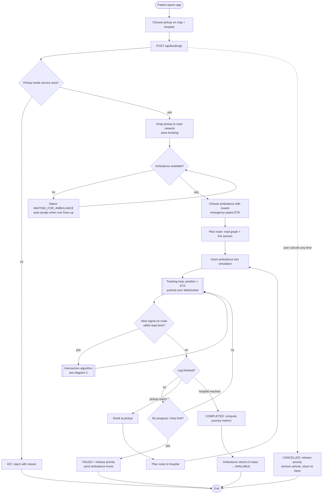
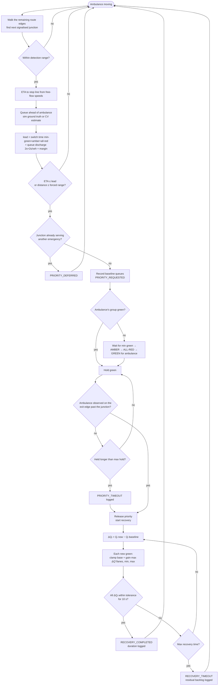
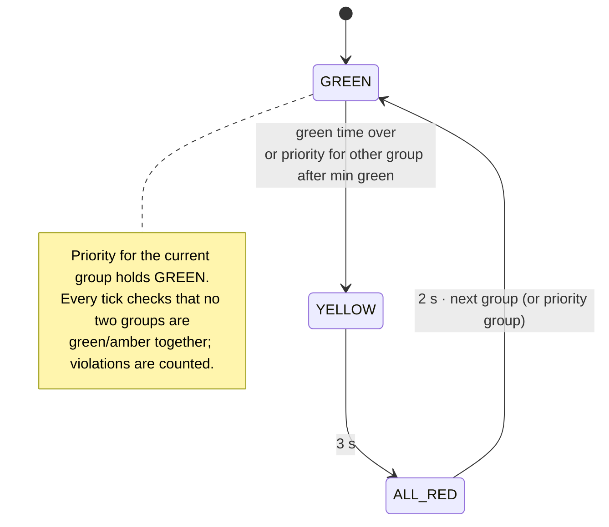
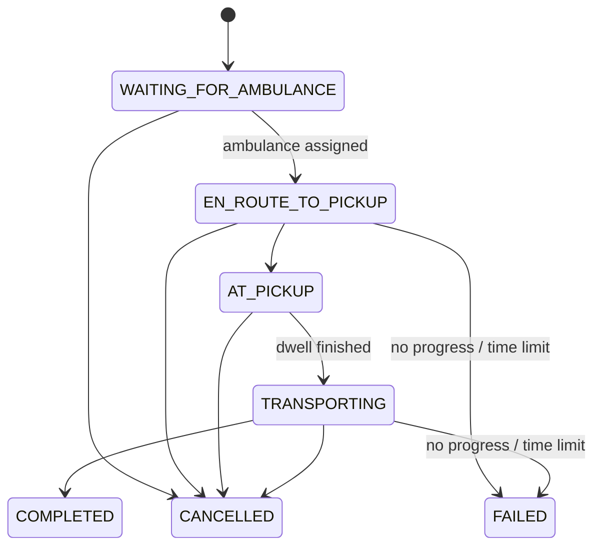
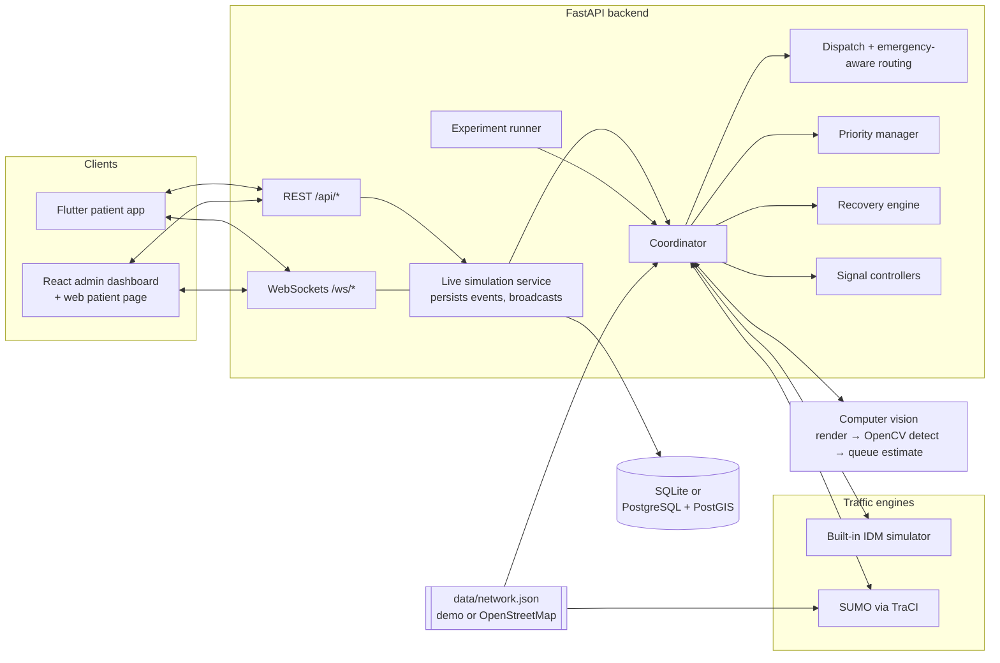

# Flowcharts

These Mermaid diagrams render directly on GitHub and in most Markdown viewers (VS Code: "Markdown Preview Mermaid Support"). Paste them into <https://mermaid.live> to export PNG/SVG for the report or slides.

## 1. End-to-end flow

## 2. Intersection-level algorithm (priority + recovery)

## 3. Signal state machine (the only transitions allowed)

## 4. Booking lifecycle

## 5. Component architecture

