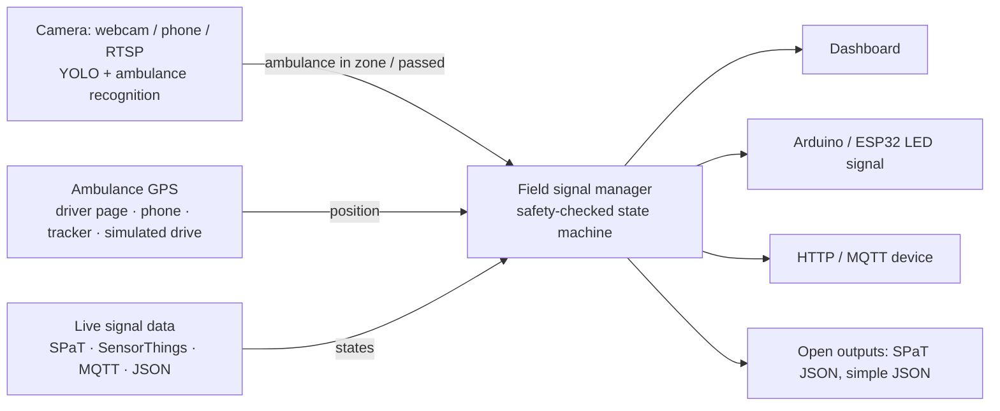

# Signals: simulated signal control, emergency corridors, (optional) LED signals

## Simulated signals on the map (default)

Every signalised junction of the loaded map (OpenStreetMap-tagged or inferred, see [maps.md](maps.md)) runs a
**simulated** signal controller – no live signal data is read:

* **Normal:** fixed-time two-phase cycle – green (25 s) → amber (3 s) → all-red (2 s) → other phase, with a per-junction offset.
  Only GREEN → AMBER → ALL-RED → GREEN transitions exist, so crossing greens are impossible; every step re-checks it.
* **Ambulance approaching → green.** Four triggers use the same safe path (current green keeps its minimum, then amber, all-red, green):
  1. a simulated ambulance on a booking – route-aware: requested when its ETA reaches *switch time + queue-discharge time + margin*;
  2. a **test ambulance** sent through any junction (Intersections tab → *Send test ambulance through*);
  3. a **camera** (webcam, phone, RTSP, video file) attached to an approach on the Video AI tab, target *Simulated junction*:
     `AMBULANCE_IN_ZONE` → green for that approach;
  4. an **operator** (Intersections tab → *Green now*), released by hand or after 45 s.
* **Ambulance passed → normal.** Route priority is released when the ambulance is observed past the junction; camera
  priority 2 s after its track crosses the stop line (4 s grace if the track is lost; 90 s max hold for everything).
  The junction then runs **adaptive recovery** – longer greens for the held approaches until queues are back to their
  pre-emergency baseline – and returns to its normal cycle.

The Signals tab shows all of them on the map with live phase colours (zoom in to see each approach), counts per mode,
the busiest junctions, current emergency activity and which cameras drive which signals. API:
`POST /api/intersections/{id}/priority`, `POST /api/intersections/{id}/test-ambulance` ([api.md](api.md)).

## LED / external signals (advanced, optional)

The rest of this page is about the stand-alone wall-clock junctions under **Signals → advanced**. They are separate from the simulated city. Each one runs in wall-clock time and can be:

- **controlled** by ResQRoute (`mode: control`). Its states drive an output: the dashboard, an Arduino or ESP32 LED traffic light, an HTTP device, or an MQTT topic.
- **mirrored** from a live external signal feed (`mode: mirror`). In this mode we cannot switch the lights, so the system logs **advisory** decisions instead ("this approach should be green now").

## The emergency corridor

When an ambulance approaches a junction along its route:

1. **Detection.** An ambulance is detected in one of two ways:
   - **Camera**: a camera attached to an approach recognises an ambulance inside its zone (`AMBULANCE_IN_ZONE`).
   - **GPS**: the ambulance is within the corridor radius (400 m by default), on one of the junction's approaches, and moving towards the junction. Its ETA must be shorter than the time needed to switch the signal: minimum green + amber + all-red, plus the queue discharge time measured by a camera, plus a margin.
2. **Request.** The junction requests green for that approach.
   - The current conflicting green is cut short only after its minimum green has run.
   - It then always goes through **amber → all-red → green**. Opposite approaches share a phase, so crossing greens are impossible.
   - Every tick re-checks this rule, and violations are counted (always 0 in tests).
3. **Hold.** The green is held while the ambulance approaches.
4. **Release.** The priority is released as soon as the ambulance has passed:
   - **Camera**: its track crosses the stop line, followed by a 2 s clearance.
   - **GPS**: after the closest approach it moves away by more than 25 m.
   - **Safety nets**: lost camera tracks are released after 4 s and GPS silence after 30 s. A 90 s maximum hold applies in all cases.
5. **Back to normal.** The ambulance's green ends after its minimum green. The approaches that were held red get **compensation green**, equal to 0.5 × the hold time, capped at 20 s. If cameras watch those approaches, their measured queues extend the green further, within the plan's maximum. The junction then returns to its normal cycle (`RECOVERY → NORMAL` in the log).

Each junction handles one emergency at a time. A second request is queued and served next, and every step is logged.

## Getting ambulance positions
- **Camera:** attach any video source (Video AI tab) to a junction approach. See [video.md](video.md).
- **Driver mode:** tick *send my location* on the Signals tab, on the phone in the ambulance. Browsers only share GPS over **https** or on `http://localhost`. To use a phone, expose the dashboard through an HTTPS tunnel (for example `cloudflared tunnel --url http://localhost:8000` or `ngrok http 8000`) and open that URL on the phone.
- **Any tracker or app:** `POST /api/field/ambulances/<id>/position` with `{"lat": .., "lon": .., "speed": m/s, "heading": deg}`.
- **Simulated drive:** pick junctions in order, choose the entry approach and the speed, then press *Drive*.
- **Simulated city:** ambulances moving on the Live map are also fed to the real-time junctions (*follow simulated ambulances*).

## Live signal data in open formats

| Format | What it is | Configure |
|---|---|---|
| **SAE J2735 SPaT** (JSON) | The standard V2X *Signal Phase and Timing* message, as decoded to JSON by RSU and V2X tools. `eventState` can be a name or a code. | `{"type": "spat", "url": "<http(s) URL or file>", "intersection_id": 101, "group_map": {"2": "N", "4": "E", "6": "S", "8": "W"}}` |
| **OGC SensorThings API** | The open IoT standard several cities use to publish sensor data, sometimes including traffic-light states. The latest Observation of one Datastream per approach is read. | `{"type": "sensorthings", "base_url": "https://<server>/v1.1", "datastreams": {"N": 1234, "E": 1235}, "value_map": {"<raw value>": "G"}}` |
| **MQTT** | Push feeds carrying SPaT, simple JSON or SensorThings observations. | `{"type": "mqtt", "host": "...", "port": 1883, "topic": "...", "format": "spat", "group_map": {...}}` |
| **Simple JSON** | `{"approaches": {"N": "green", "E": "red"}}`. Colour words in several languages and G/Y/R letters are understood. | `{"type": "json", "url": "<URL or file>"}` |

Use **Test source** in the form to see what a feed reports before saving.

**Finding real feeds:**
- Public live signal data is rare. Some cities publish it through SensorThings or MQTT urban-data platforms, and US DOT V2X deployments and testbeds publish SPaT.
- Indian cities do not currently publish open live signal states.
- Check each provider's documentation for the endpoint, the Datastream IDs and the meaning of the result codes. Then fill in `value_map`, because codes differ between providers.
- Respect each provider's licence and rate limits. A 1 s polling interval is the default.

**Outputs.** Every junction also *publishes* its state in open formats:
- `GET /api/field/junctions/<id>/spat` gives J2735-style SPaT JSON.
- `GET /api/field/junctions/<id>/state` gives simple JSON.
- The MQTT or HTTP driver can push SPaT.

As a self-test, a second junction can *mirror* the first junction's `/spat` URL.

## Physical demo signal
See [`hardware/README.md`](../hardware/README.md). An Arduino Uno (USB serial) or an ESP32 (Wi-Fi HTTP) drives 12 LEDs as a 4-way signal. The firmware has its own conflict monitor and falls back to flashing amber if the PC stops sending. The backend sends a heartbeat every 2 s.

## Safety and legality
- This is a research prototype.
- Only connect the outputs to **model or demonstration** signals.
- Real street signals must be operated by certified controllers. Emergency pre-emption must be authorised and implemented by the traffic authority, for example through NTCIP pre-emption inputs or a vendor's priority interface.
- In mirror mode the system never sends anything to the external signal.
