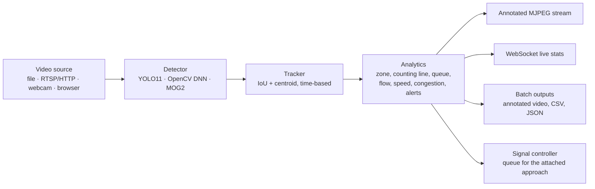

# Video analytics: YOLO and OpenCV on real traffic

This module runs vehicle detection on **real video**: uploaded files, live IP or RTSP cameras, a webcam on the laptop, or your browser or phone camera. It streams the annotated video and live statistics to the dashboard (**Video AI** tab). Any camera can be attached to a junction approach so that its measured queue drives the emergency-priority and recovery logic live.

## Pipeline



| Detector | What it is | When to use it |
|---|---|---|
| `yolo` | Ultralytics **YOLO11n** (PyTorch), 80 COCO classes, about 80 ms/frame on a laptop CPU | Default and most accurate. Weights are included in `computer_vision/models/yolo11n.pt`. |
| `yoloe` | **YOLOE-11s** open-vocabulary model with a traffic vocabulary (car, bus, truck, van, motorcycle, **auto rickshaw**, **ambulance**, bicycle, person), about 300 ms/frame | Detects auto-rickshaws and ambulances directly. Slower. |
| `opencv-dnn` | The same network exported to **ONNX** and run with **OpenCV's DNN module** (`cv2.dnn`), with letterboxing and NMS done in OpenCV | Use when PyTorch isn't available. `yolo11n.onnx` is included; regenerate it with `computer_vision/tools/export_onnx.py`. |
| `motion` | Classical OpenCV: MOG2 background subtraction, morphology and contours | Needs no ML model. Works only with a fixed camera and can't tell vehicle types apart. Stopped cars fade into the background, so it under-counts queues. |
| `auto` | YOLO if installed, otherwise OpenCV DNN, otherwise motion | |

**Measures**, computed per frame inside the zone (the polygon around the approach lanes):
- Vehicles by class.
- **Queue**: tracked vehicles that have moved slower than 2% of the frame width per second for at least 1 s.
- Queue length from the stop line, in pixels, or in metres if you set `meters_per_pixel`.
- Occupancy.
- Congestion level: free, moderate, heavy or jam.
- Mean speed.
- **Line crossings** in each direction, and **flow** in vehicles per minute over a 60 s window.

## Telling ambulances apart from other vehicles

The stock COCO model calls an ambulance a "truck" or "car". The pipeline adds an **ambulance verifier** on top of every tracked vehicle. It combines independent cues and requires them to persist over several frames. Full details, training data and accuracy: [ambulance_model.md](ambulance_model.md).

| Cue | How it works | Strengths and weaknesses |
|---|---|---|
| **Trained vehicle classifier** | **YOLO11n-cls** (`computer_vision/models/vehicle_cls.pt`, ONNX copy for OpenCV), trained by us on ~7,500 real vehicle crops from public Indian traffic and ambulance datasets plus 3,600 synthetic hard negatives. Classes: ambulance, fire/police, auto-rickshaw, bus, motorcycle, car. Runs on each tracked vehicle in a background thread. | Learned what ambulances (and auto-rickshaws) look like. On held-out crops: 93% vehicle-type accuracy; with the fusion, 85% of ambulances recognised at 95% precision (0.6% false alarms). |
| **'AMBULANCE' text** | Offline OCR (RapidOCR, PP-OCRv3) reads the vehicle, normally and mirrored (bonnets); "108"/"102"/"EMERGENCY" count as weaker evidence. | Very specific when the lettering is readable. |
| **Flashing beacon** | Measures the share of bright, saturated red and blue pixels in the light-bar region of each vehicle over 2.5 s. *Flashing* (high variation, with red and blue alternating) scores; static red paint does not. | Very distinctive when the lights are on, especially at night. Needs the beacon to be visible and switched on. |
| **Livery** (weak) | A mostly white or yellow body with high-saturation markings. | Support only. |
| Open-vocabulary model (fallback) | YOLOE with an *ambulance* prompt, used only when the trained classifier file is missing. | Weak on Indian ambulances. |

How the cues combine:
- `frame score = logistic fusion of the cues` (`computer_vision/video/ambulance_fusion.py`; weights fitted on validation data and stored in `models/ambulance_fusion.json`).
- The track score is an exponential moving average of the frame score.
- A vehicle becomes an **ambulance** once its score is ≥ 0.5 for 3 updates, and drops back below 0.25.
- Recognised ambulances get a red box labelled **AMBULANCE** with the cues that fired. They raise `EMERGENCY_VEHICLE`, then `AMBULANCE_IN_ZONE` (inside the approach zone, with an "approaching" flag and ETA), then `AMBULANCE_PASSED` (crossed the stop line) or `AMBULANCE_LOST`.
- A camera attached to a **Signals** junction turns those events into green and release. See [signals.md](signals.md).

To measure it on your own clips, put ambulance and non-ambulance clips in two folders and run:
```bash
python -m computer_vision.evaluation.ambulance_eval --root data/videos/eval
python -m computer_vision.evaluation.ambulance_eval --root data/videos/eval --no-beacon
python -m computer_vision.evaluation.ambulance_eval --root data/videos/eval --no-model
```
The script reports clip-level recall, false-alarm rate and time to recognise. Run it with each cue switched off to get an ablation table for your report. YouTube has many Indian ambulance clips. Record your own, or use clips whose licence allows research use.

Honest limits:
- Accuracy numbers come from public photo datasets, not from your cameras; add your own ambulance photos and re-train ([ambulance_model.md](ambulance_model.md)) before quoting numbers for a site.
- The beacon cue needs the lights on; OCR needs readable lettering.

## What is drawn: vehicles, people or every object

**Show** (when adding a source, and live on the source page):

| Setting | Draws | Default for |
|---|---|---|
| all objects | every one of the model's classes – people, phones, cups, chairs… (grey boxes) plus road vehicles (coloured) | webcams and the browser camera, so you immediately see detection working indoors |
| vehicles + people | road vehicles and pedestrians | |
| road vehicles only | car, motorcycle, bus, truck, bicycle, auto-rickshaw, ambulance… | uploaded videos and stream URLs |

Traffic numbers (vehicles in zone, queue, flow, congestion) and ambulance recognition always use road vehicles only.
Cameras start at confidence 0.25 (videos 0.35); change it live on the source page.

**Test detector** (Add source form, runs automatically for cameras) runs the selected model on a bundled street photo
and reports what it found and how long it took – e.g. "yolo (yolo11n.pt) works – found bus, person, person … in 82 ms".
If it says only motion detection is available, YOLO is not installed: re-run the setup script (or pick *YOLO via OpenCV
DNN*, which needs only OpenCV and the bundled ONNX model). The source page also shows "In view now: …" for every frame
and a warning when a camera runs without an object model.

## Photos

**Video AI → + Add → Photo**: drop one or more photos (up to 100; jpg, png, webp, bmp, tif) or try the bundled street
photo. With the browser camera running, **📸 Analyse a photo of this view** sends a full-resolution still of what the camera sees.
*Accurate* quality (default) runs YOLO11m on the whole photo at 1280 px **plus 2×2 tiles** and fuses the boxes, so crowded scenes and small or distant vehicles are found; *fast* uses one 960 px pass. Each photo gives:
- every detected object, with road vehicles by class and pedestrians;
- **road occupancy**, the share of the photo (or of a zone) covered by vehicles, and a congestion level. Fewer than 3 vehicles always counts as free, so a single close-up bus is not "congestion";
- an **ambulance check** per vehicle: trained classifier + 'AMBULANCE' text (OCR) + a *lit* light bar + livery, fused as above, with the reasons and the classifier's top vehicle types shown per vehicle. Auto-rickshaws and fire/police vehicles are relabelled by the classifier;
- an annotated JPEG, the original, and `results.csv` / `results.json` for the whole batch (under `results/video/photos/<id>/`).

API: `POST /api/video/photos` (multipart `files` + `detector`, `conf`, `detect`, `ambulance`, `imgsz`, `quality` = accurate|fast), `GET /api/video/photos[/{id}]`.

## Speed (frames per second)

| Lever | Effect |
|---|---|
| **Speed** setting (detector input 320 / 480 / 640 / 960 px) | Cameras default to 480 px, about 2× the frame rate of 640 px on a CPU (12 → 23 fps for YOLO11n on the development machine, 6 → 14 fps for OpenCV DNN using the bundled `yolo11n-416.onnx`). Use 640–960 px for far-away vehicles. Can be changed live. |
| GPU | Used automatically: NVIDIA CUDA (with FP16) or Apple-silicon MPS. Force a device with `YOLO_DEVICE=cpu` or `cuda:0`. |
| Ambulance verifier model | The slower YOLOE check runs in a **background thread** on the newest frame, so it no longer lowers the camera's frame rate (batch processing keeps it in step with the frames). |
| HD / Full-HD cameras | Frames are scaled to at most 1280 px wide before processing. The detector uses 640 px anyway, and drawing, JPEG streaming and colour checks get much cheaper. |
| Browser camera | Two frames in flight, with no idle pause between replies. The live frame rate is shown next to the button. |
| Max fps | Server cameras process up to 15 fps by default (up to 30), changeable live. |

## Connection drops (fixed)

- **Browser camera:** if the connection to the backend drops (backend restarted, Wi-Fi blip, laptop sleep), the camera
  stays on and the page reconnects automatically (shown as *reconnecting… camera stays on*). The backend re-creates the
  camera source with the same id and settings, so analysis just continues. A keep-alive ping and a watchdog prevent stalls.
  A bad frame no longer closes the connection.
- **Server webcam:** short frame-read glitches, which are common with Windows webcam drivers, are tolerated. If the camera really
  disappears (unplugged, taken by another app, laptop resumed), it is reopened automatically with back-off instead of
  stopping with an error. The page shows how often it reconnected, and the video stream reconnects by itself.

## Webcam tips
- **Video AI → + Add → Server webcam** scans cameras 0–4. It tries DirectShow and Media Foundation on Windows, AVFoundation on macOS, and V4L2 on Linux, and only lists cameras that actually deliver frames.
- **Windows:** close Zoom, Teams or the Camera app, because only one program can use a webcam.
- **macOS:** allow camera access for Terminal (or your Python IDE) in *System Settings → Privacy & Security → Camera*, then restart the backend.
- **This browser's camera** works in any browser on `http://localhost`, needs no driver setup, and runs the same pipeline.
- **Command line:** `python computer_vision/detect_video.py --source 0 --show` opens a live window with YOLO boxes and ambulance alerts.

## Using it

### From the dashboard
Open the **Video AI** tab, click **+ Add**, and pick a source:

- **Upload video**
  - *live playback* plays the file in real time with live stats.
  - *batch* processes the whole file and gives you an annotated video, a per-frame CSV, a per-second timeline CSV and `summary.json`.
- **Sample video**: a bundled parking-lot clip (CC BY 4.0) for a quick test.
- **Camera stream**: any RTSP, HTTP or MJPEG URL. Use this for **live traffic from a phone**:
  1. Install an "IP Webcam"-type app on an Android phone.
  2. Start its server.
  3. Paste its `http://<phone-ip>:8080/video` URL. The phone must be on the same Wi-Fi as the laptop.
  4. Point the phone at the road from a window or footbridge.
- **Server webcam**: camera index 0 on the machine running the backend.
- **This browser's camera**: the browser sends frames to the backend and draws the detections on the live preview. This works on `http://localhost`. Phones need HTTPS, so use the IP-camera route on a phone instead.

Then on the source page:
1. Click **Draw zone**, then click the corners of the approach lanes on the video. Click **Draw counting / stop line** and click its two ends. Save each.
2. Under **Connect this camera to a signal**, choose *Simulated junction (map)*, a junction (named after its crossing roads) and the approach ("from north · Palm Beach Road"), then click **Attach**. When the camera recognises an ambulance in its zone, that approach of the simulated signal turns green; when it crosses the stop line the junction recovers. The camera's queue also replaces the simulated queue for that approach:
   - The Intersections tab shows 📷 *live camera* on that approach.
   - Priority lead times and recovery use the measured queue.
   - If the camera stops for more than 5 s, the controller falls back to the simulator.

### From the command line (no backend needed)
```bash
python computer_vision/detect_video.py --source my_clip.mp4 --out results/my_clip_annotated.mp4
python computer_vision/detect_video.py --source 0 --show                                    # webcam window
python computer_vision/detect_video.py --source http://192.168.1.23:8080/video --show      # phone camera
python computer_vision/detect_video.py --source my_clip.mp4 --detector opencv-dnn --roi 0 0.4 1 0.4 1 1 0 1 --line 0 0.75 1 0.75
```

### API
See [api.md](api.md#video-analytics). In short:
- `POST /api/video/upload` (multipart) or `POST /api/video/sources`.
- `GET /api/video/sources/{id}/stream.mjpg` for the annotated live video.
- `WS /ws/video/{id}` for live stats.
- `WS /ws/video/{id}/push` to push browser frames.
- `PATCH /api/video/sources/{id}` to set the zone and line, or attach to an approach.

## Tips for good results on Indian roads
- Film from **above and at an angle** (30–60°), such as a footbridge over Palm Beach Road or a building near a junction. Straight-down views make the COCO model confuse cars with phones or suitcases. The bundled parking-lot sample shows this.
- Keep the camera still (a tripod or a phone clamp). Process at 6–10 fps, which is enough for counting and queues.
- Draw the zone tightly around the approach lanes, and put the counting line at the stop line.
- Auto-rickshaws usually come out as `car`, `motorcycle` or `truck`. Two-wheelers in dense traffic merge into one box. Fine-tuning fixes both.

## Training your own model (recommended for the report)
`computer_vision/train/train_yolo.py` walks through it:
1. Extract frames from your clips.
2. Label them (CVAT, Label Studio, Roboflow or makesense.ai) with classes such as `car, motorcycle, auto_rickshaw, bus, truck, bicycle, ambulance`.
3. Run `train_yolo.py train --data dataset.yaml`. A free Colab or Kaggle GPU is fastest.
4. Copy `best.pt` to `computer_vision/models/` and select it as the weights.

Report the validation precision, recall and mAP that training prints.

## How to evaluate it
- **Counting accuracy**: count the vehicles crossing the line in a 2–5 minute clip by hand. Compare with `line_crossings` in `summary.json` and report absolute and percentage error per class.
- **Queue accuracy**: at 10 random timestamps, count the stopped vehicles in the zone yourself and compare with `frames.csv` → `queue`.
- **Detector comparison**: run the same clip with `yolo`, `opencv-dnn` and `motion`, and compare counts and processing fps.
- For the simulated cameras, `python -m computer_vision.evaluation.evaluate` scores detections against exact ground truth.

## Licences
- YOLO11 weights and the Ultralytics library are AGPL-3.0, which is fine for an academic project. Cite Ultralytics.
- The sample video is © Intel, CC BY 4.0. See `data/videos/samples/ATTRIBUTION.md`.
- Only process video you are allowed to record and use, and avoid storing identifiable footage longer than needed.
